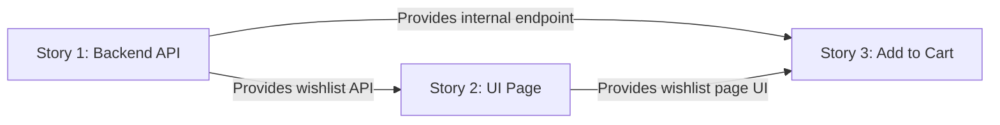

# Breakdown — PER-316

**Epic:** Signed-in shoppers can save a wishlist and add those items to the cart

---

## Overview

This breakdown splits the wishlist feature into three independently shippable stories: (1) backend wishlist storage and API, (2) UI wishlist page with add/remove/view, (3) add-to-cart integration. Each story delivers a testable increment; the epic's acceptance criteria are covered across the three stories. The order ensures providers are built before consumers: persistence API before UI, UI before cart integration.

---

## Story 1: Backend wishlist storage and API

**Repo:** `app`

### Context

This story implements the persistence layer and REST API for the wishlist feature. It creates the `wishlist_item` table in the customer service database, exposes CRUD endpoints for adding/removing/listing wishlist items, and enforces signed-in-only access. The customer service owns wishlist data; product service provides availability status. This foundational work enables Story 2 (UI) and Story 3 (cart integration) to function.

### Scope

**New files:**
- `customer/src/main/resources/db/changelog/ddl/changelog-0002.sql` — Liquibase migration for `wishlist_item` table
- `customer/src/main/java/com/yas/customer/model/WishlistItem.java` — JPA entity with `customer_id`, `product_id`, audit fields
- `customer/src/main/java/com/yas/customer/repository/WishlistItemRepository.java` — Spring Data JPA repository with queries for `findByCustomerId`, `findByCustomerIdAndProductId`, `findByIdAndCustomerId`
- `customer/src/main/java/com/yas/customer/service/WishlistService.java` — Business logic: add, list, remove, getById
- `customer/src/main/java/com/yas/customer/controller/WishlistController.java` — REST controller for `/api/customer/storefront/wishlist/items` endpoints
- `customer/src/main/java/com/yas/customer/viewmodel/wishlist/WishlistItemPostVm.java` — Request ViewModel for POST (add product)
- `customer/src/main/java/com/yas/customer/viewmodel/wishlist/WishlistItemVm.java` — Response ViewModel for single wishlist item (list response)
- `customer/src/main/java/com/yas/customer/viewmodel/wishlist/WishlistItemListVm.java` — Response ViewModel for list endpoint (`{ items: [...] }`)
- `customer/src/main/java/com/yas/customer/viewmodel/wishlist/WishlistItemDetailVm.java` — Response ViewModel for internal `GET /{id}` endpoint (for Story 3)
- `customer/src/test/java/com/yas/customer/controller/WishlistControllerTest.java` — Unit tests for controller (8 test cases)
- `customer/src/test/java/com/yas/customer/service/WishlistServiceTest.java` — Unit tests for service (8 test cases)
- `customer/src/it/java/com/yas/customer/service/WishlistServiceIT.java` — Integration tests (4 test cases)

**Modified files:**
- `customer/src/main/resources/db/changelog/db.changelog-master.yaml` — Add `changelog-0002.sql` via `includeAll` (auto-included)
- `customer/src/main/java/com/yas/customer/config/SecurityConfig.java` — Add `/api/customer/storefront/wishlist/**` to authenticated paths

### Implementation Pointers

**Entity (new):**
- Class: `WishlistItem` in `customer/src/main/java/com/yas/customer/model/WishlistItem.java`
  - Extends `AbstractAuditEntity` (from `common-library`)
  - Fields: `id` (Long, primary key), `customerId` (String, Keycloak user ID), `productId` (Long)
  - Annotation: `@Table(uniqueConstraints = @UniqueConstraint(name = "uk_wishlist_customer_product", columnNames = {"customer_id", "product_id"}))`

**Repository (new):**
- Interface: `WishlistItemRepository` in `customer/src/main/java/com/yas/customer/repository/WishlistItemRepository.java`
  - Extends `JpaRepository<WishlistItem, Long>`
  - Methods: `findByCustomerIdOrderByCreatedDateDesc(String customerId)`, `findByIdAndCustomerId(Long id, String customerId)`, `findByCustomerIdAndProductId(String customerId, Long productId)`

**Service (new):**
- Class: `WishlistService` in `customer/src/main/java/com/yas/customer/service/WishlistService.java`
  - Method: `addProductToWishlist(String customerId, Long productId)` — Verify product exists via `ProductService.getProduct()`, INSERT if not exists, catch `DataIntegrityViolationException` for idempotent behavior
  - Method: `getWishlistItems(String customerId)` — SELECT wishlist items, fetch product details in parallel with `CompletableFuture` (2s timeout per product), populate `isAvailable` from product service response (`published` AND `stockQuantity > 0`)
  - Method: `removeFromWishlist(String customerId, Long wishlistItemId)` — DELETE WHERE `id` AND `customer_id` match, throw `NotFoundException` if not found
  - Method: `getWishlistItemDetail(Long wishlistItemId)` — SELECT wishlist item, call product service to determine `isAvailable`, return `WishlistItemDetailVm` (for Story 3)
  - Dependency: `ProductService` (verify in `customer/src/main/java/com/yas/customer/service/ProductService.java`; create if missing, following `LocationService` pattern)

**Controller (new):**
- Class: `WishlistController` in `customer/src/main/java/com/yas/customer/controller/WishlistController.java`
  - Endpoint: `POST /api/customer/storefront/wishlist/items` → `addToWishlist(@RequestBody WishlistItemPostVm)` with `@PreAuthorize("isAuthenticated()")`
  - Endpoint: `GET /api/customer/storefront/wishlist/items` → `getWishlist()` with `@PreAuthorize("isAuthenticated()")`
  - Endpoint: `DELETE /api/customer/storefront/wishlist/items/{wishlistItemId}` → `removeFromWishlist(@PathVariable Long wishlistItemId)` with `@PreAuthorize("isAuthenticated()")`
  - Endpoint: `GET /api/customer/storefront/wishlist/items/{wishlistItemId}` → `getWishlistItemDetail(@PathVariable Long wishlistItemId)` with `@PreAuthorize("isAuthenticated()")` (internal, for Story 3)
  - Extract `customerId` from JWT via `AuthenticationUtils.getCurrentUserId()` (from `common-library`)

**ViewModels (new):**
- `WishlistItemPostVm` — Record with `@NotNull Long productId`
- `WishlistItemVm` — Record with `wishlistItemId`, `productId`, `productName`, `productSlug`, `thumbnailUrl`, `price`, `isAvailable`, `discontinuedMessage`
- `WishlistItemListVm` — Record with `List<WishlistItemVm> items`
- `WishlistItemDetailVm` — Record with `wishlistItemId`, `customerId`, `productId`, `isAvailable`

**Migration (new):**
- File: `customer/src/main/resources/db/changelog/ddl/changelog-0002.sql`
- Changeset: `--changeset wishlist:issue-316-1`
- SQL: `CREATE TABLE wishlist_item (id BIGSERIAL PRIMARY KEY, customer_id VARCHAR(255) NOT NULL, product_id BIGINT NOT NULL, created_date TIMESTAMP NOT NULL DEFAULT CURRENT_TIMESTAMP, last_modified_date TIMESTAMP, CONSTRAINT uk_wishlist_customer_product UNIQUE (customer_id, product_id)); CREATE INDEX idx_wishlist_customer ON wishlist_item (customer_id);`

**Security (modified):**
- File: `customer/src/main/java/com/yas/customer/config/SecurityConfig.java`
- Change: Add `.requestMatchers("/api/customer/storefront/wishlist/**").authenticated()` to `authorizeHttpRequests()` configuration

### Acceptance Criteria

1. **AC-1 (persistence):** Given a signed-in shopper, when they add a product to their wishlist via API, then the product is persisted in the `wishlist_item` table. Given a signed-in shopper with items on their wishlist, when they sign out and sign back in, then their wishlist still contains the same items. Given a signed-in shopper viewing their wishlist via API, when they remove an item, then that item is deleted from the `wishlist_item` table.

2. **AC-2 (no duplicates):** Given a signed-in shopper, when they add a product already on their wishlist, then the API returns 200 OK and the database does not create a duplicate entry.

3. **AC-5 (guest handling — backend enforcement):** Given a guest (no JWT or invalid JWT), when they attempt to call any wishlist API endpoint, then the backend returns 401 Unauthorized and no wishlist data is saved.

### Dependencies

None — this story is foundational.

### Out of Scope

- UI for wishlist page (Story 2 delivers this)
- Add-to-cart integration (Story 3 delivers this)
- Wishlist item quantity or variants (future enhancement)
- Batch product fetch endpoint in product service (open question; this story implements parallel calls as fallback)

### Verification Approach

**8 unit tests** in `WishlistServiceTest`:
1. `testAddProductToWishlist_Success` — Add a product, verify repository save called
2. `testAddProductToWishlist_Idempotent` — Add existing product, verify no duplicate save
3. `testAddProductToWishlist_ProductNotFound` — Product service returns 404, verify `NotFoundException` thrown
4. `testGetWishlistItems_Success` — Retrieve items, verify product service called for each item
5. `testGetWishlistItems_ProductUnavailable` — Product service returns 404 or unavailable, verify `isAvailable: false`
6. `testRemoveWishlistItem_Success` — Remove item, verify repository delete called
7. `testRemoveWishlistItem_NotFound` — Item does not exist, verify `NotFoundException` thrown
8. `testGetWishlistItemInternal_Success` — Retrieve internal view, verify fields

**4 integration tests** in `WishlistServiceIT`:
1. `testAddProductToWishlist_PersistsAcrossSessions` — Add product, flush session, reload, verify item exists (AC-1)
2. `testAddProductToWishlist_NoDuplicates` — Add same product twice, verify UNIQUE constraint (AC-2)
3. `testGetWishlistItems_CallsProductService` — Verify real HTTP call to product service (use WireMock or Testcontainers)
4. `testRemoveWishlistItem_DeletesFromDatabase` — Remove item, verify row deleted

**5 controller tests** in `WishlistControllerTest`:
1. `testAddProductToWishlist_ReturnsOk` — POST `/items`, verify 200
2. `testAddProductToWishlist_Unauthorized` — POST without JWT, verify 401 (AC-5)
3. `testGetWishlistItems_ReturnsOk` — GET `/items`, verify 200 and correct response structure
4. `testRemoveWishlistItem_ReturnsNoContent` — DELETE `/items/{id}`, verify 204
5. `testRemoveWishlistItem_NotFound` — DELETE non-existent item, verify 404

**Total: 17 tests**

---

## Story 2: Storefront wishlist page

**Repo:** `app`

### Context

This story implements the UI for the wishlist feature, allowing signed-in shoppers to view their saved items, remove items, and see discontinued product status. The page calls the backend wishlist API (Story 1) to fetch items and handle removals. Guests are redirected to the sign-in page when attempting to access the wishlist. This story delivers the user-facing wishlist experience, enabling shoppers to manage their saved products before Story 3 adds the ability to add them to the cart.

### Scope

**New files:**
- `storefront/src/app/wishlist/page.tsx` — Wishlist page component (Next.js page)
- `storefront/src/app/wishlist/WishlistItem.tsx` — Wishlist item card component (displays product details, remove button, discontinued status)
- `storefront/src/services/wishlistService.ts` — API client for wishlist endpoints (`getWishlistItems`, `removeWishlistItem`)
- `storefront/src/types/wishlist.ts` — TypeScript interfaces for wishlist data (`WishlistItem`, `WishlistItemListResponse`)
- `storefront/__tests__/wishlist/page.test.tsx` — Unit tests for wishlist page (5 test cases)
- `storefront/__tests__/wishlist/WishlistItem.test.tsx` — Unit tests for wishlist item component (3 test cases)

**Modified files:**
- `storefront/src/components/Header.tsx` — Add "Wishlist" link to navigation menu (next to "Cart"), visible only when signed in
- `storefront/src/app/product/[slug]/page.tsx` — Add "Add to Wishlist" button (calls `POST /api/customer/storefront/wishlist/items`, shows success/error toast)
- `storefront/src/services/authService.ts` — Verify JWT presence for wishlist link visibility and guest redirect logic

### Implementation Pointers

**Wishlist Page (new):**
- Component: `page.tsx` in `storefront/src/app/wishlist/`
  - Check JWT presence on mount (`authService.isAuthenticated()`); if false, redirect to `/login?returnUrl=/wishlist`
  - Fetch wishlist items on mount via `wishlistService.getWishlistItems()`
  - Render `WishlistItem` component for each item
  - Handle empty state: show "Your wishlist is empty" message with link to continue shopping
  - Loading state: show skeleton loaders while fetching
  - Error state: show error message with retry button

**Wishlist Item Component (new):**
- Component: `WishlistItem.tsx` in `storefront/src/app/wishlist/`
  - Props: `item` (WishlistItem interface), `onRemove` callback
  - Display: Product thumbnail, name, price, "Remove" button
  - Discontinued handling: If `isAvailable === false`, show `discontinuedMessage` in red text, disable "Add to Cart" button (Story 3 will add this button)
  - Remove button: Calls `onRemove(item.wishlistItemId)`, parent calls `wishlistService.removeWishlistItem()`, shows toast on success/error

**API Client (new):**
- File: `storefront/src/services/wishlistService.ts`
  - Function: `getWishlistItems()` — GET `/api/customer/storefront/wishlist/items`, returns `Promise<WishlistItemListResponse>`
  - Function: `removeWishlistItem(wishlistItemId: number)` — DELETE `/api/customer/storefront/wishlist/items/{wishlistItemId}`, returns `Promise<void>`
  - Function: `addProductToWishlist(productId: number)` — POST `/api/customer/storefront/wishlist/items` with `{"productId": productId}`, returns `Promise<void>`
  - Use `fetch` with JWT from `authService.getToken()` in `Authorization` header

**TypeScript Interfaces (new):**
- File: `storefront/src/types/wishlist.ts`
  ```typescript
  export interface WishlistItem {
    wishlistItemId: number;
    productId: number;
    productName: string;
    productSlug: string;
    thumbnailUrl: string | null;
    price: number;
    isAvailable: boolean;
    discontinuedMessage: string | null;
  }

  export interface WishlistItemListResponse {
    items: WishlistItem[];
  }
  ```

**Header Navigation (modified):**
- File: `storefront/src/components/Header.tsx`
  - Add wishlist link: `<Link href="/wishlist">Wishlist</Link>` next to cart link
  - Show only if `authService.isAuthenticated()` returns true (same logic as "My Account" link)

**Product Page Add-to-Wishlist Button (modified):**
- File: `storefront/src/app/product/[slug]/page.tsx`
  - Add button: "Add to Wishlist" next to "Add to Cart" button
  - On click: Check JWT (`authService.isAuthenticated()`); if false, redirect to `/login?returnUrl=/product/{slug}`; if true, call `wishlistService.addProductToWishlist(productId)`, show success toast ("Product added to wishlist") or error toast
  - Button disabled state: Show "Added" if product is already on wishlist (optional enhancement; not required for AC)

### Acceptance Criteria

1. **AC-1 (view and remove):** Given a signed-in shopper viewing their wishlist, when they remove an item, then that item is no longer on their wishlist. (UI reflects backend removal from Story 1.)

2. **AC-4 (discontinued product display):** Given a signed-in shopper with a discontinued product on their wishlist, when they view their wishlist, then the discontinued product is displayed with a message indicating it cannot be added to the cart.

3. **AC-5 (guest redirect):** Given a guest (not signed in), when they attempt to access the wishlist page, then they are redirected to sign in. (UI checks JWT and redirects to `/login?returnUrl=/wishlist`.)

### Dependencies

- **Story 1** — This story depends on Story 1's wishlist API endpoints (`GET /items`, `DELETE /items/{id}`, `POST /items`) being deployed and functional.

### Out of Scope

- "Add to Cart" button on wishlist items (Story 3 delivers this)
- "Add to Wishlist" button on category/search results pages (future enhancement)
- Wishlist item count badge on header (future enhancement)
- Sorting or filtering wishlist items (future enhancement)

### Verification Approach

**5 unit tests** in `page.test.tsx`:
1. `testWishlistPage_GuestRedirect` — Guest visits `/wishlist`, verify redirect to `/login?returnUrl=/wishlist` (AC-5)
2. `testWishlistPage_LoadsItems` — Signed-in user, mock `getWishlistItems()` with 2 items, verify items rendered
3. `testWishlistPage_EmptyState` — Signed-in user, mock `getWishlistItems()` returns empty array, verify "Your wishlist is empty" message
4. `testWishlistPage_RemoveItem` — Click "Remove" on item, verify `removeWishlistItem()` called, item removed from list (AC-1)
5. `testWishlistPage_ErrorState` — Mock `getWishlistItems()` throws error, verify error message and retry button

**3 unit tests** in `WishlistItem.test.tsx`:
1. `testWishlistItem_AvailableProduct` — Render item with `isAvailable: true`, verify thumbnail, name, price, remove button visible
2. `testWishlistItem_DiscontinuedProduct` — Render item with `isAvailable: false`, verify discontinued message displayed in red (AC-4)
3. `testWishlistItem_RemoveButton` — Click "Remove", verify `onRemove` callback called with correct `wishlistItemId`

**Integration test (manual or E2E):**
- Sign in, add product to wishlist from product page, navigate to `/wishlist`, verify product appears
- Remove product from wishlist, verify it disappears
- Sign out, attempt to visit `/wishlist`, verify redirect to login

**Total: 8 unit tests + 1 integration/E2E test**

---

## Story 3: Add wishlist item to cart

**Repo:** `app`

### Context

This story adds the ability to add a saved wishlist item to the cart. The cart service calls the customer service's internal wishlist endpoint to retrieve item details and validate availability, then adds the product to the cart. The wishlist item remains on the wishlist after being added to the cart (AC-3). The UI on the wishlist page (Story 2) is extended to show an "Add to Cart" button for available products and prevent the action for discontinued products (AC-4). This story completes the wishlist feature's core user journey.

### Scope

**New files:**
- `cart/src/main/java/com/yas/cart/viewmodel/WishlistItemToCartVm.java` — Request ViewModel for add-from-wishlist endpoint
- `cart/src/main/java/com/yas/cart/viewmodel/WishlistItemDetailVm.java` — Response ViewModel from customer service (internal)
- `cart/src/main/java/com/yas/cart/service/WishlistService.java` — New service for calling customer service wishlist API (`getWishlistItemById()`)
- `cart/src/test/java/com/yas/cart/service/WishlistServiceTest.java` — Unit tests for WishlistService (3 test cases)
- `cart/src/it/java/com/yas/cart/service/WishlistServiceIT.java` — Integration test for customer service call (1 test case)
- `storefront/src/app/wishlist/AddToCartButton.tsx` — UI component for "Add to Cart" button on wishlist page

**Modified files:**
- `cart/src/main/java/com/yas/cart/controller/CartItemController.java` — Add endpoint `POST /storefront/items/from-wishlist`
- `cart/src/main/java/com/yas/cart/service/CartItemService.java` — Add method `addFromWishlist(WishlistItemToCartVm vm)`
- `cart/src/main/java/com/yas/cart/config/ServiceUrlConfig.java` — Add `customer` service URL field
- `cart/src/main/resources/application.properties` — Add `yas.services.customer=http://customer-service:8080`
- `cart/src/main/resources/db/changelog/ddl/changelog-0005.sql` — Add UNIQUE constraint on `cart_item` (if missing; verify first)
- `cart/src/main/resources/db/changelog/db.changelog-master.yaml` — Include `changelog-0005.sql` (if created)
- `cart/src/test/java/com/yas/cart/controller/CartItemControllerTest.java` — Add test for `POST /storefront/items/from-wishlist` (2 test cases)
- `cart/src/test/java/com/yas/cart/service/CartItemServiceTest.java` — Add test for `addFromWishlist()` method (4 test cases)
- `customer/src/main/java/com/yas/customer/controller/WishlistController.java` — Endpoint `GET /storefront/wishlist/items/{id}` already created in Story 1 (no change needed)
- `customer/src/main/java/com/yas/customer/service/WishlistService.java` — Method `getWishlistItemDetail()` already created in Story 1 (no change needed)
- `storefront/src/app/wishlist/WishlistItem.tsx` — Add "Add to Cart" button (calls `POST /api/cart/storefront/items/from-wishlist`, shows toast)
- `storefront/src/services/cartService.ts` — Add function `addWishlistItemToCart(wishlistItemId: number)`

### Implementation Pointers

**Cart Service Controller (modified):**
- File: `cart/src/main/java/com/yas/cart/controller/CartItemController.java`
  - Endpoint: `POST /storefront/items/from-wishlist`
  - Method: `addFromWishlist(@RequestBody WishlistItemToCartVm vm)` with `@PreAuthorize("isAuthenticated()")`
  - Delegates to `CartItemService.addFromWishlist(vm)`, returns `ResponseEntity<CartItemGetVm>`

**Cart Service Service (modified):**
- File: `cart/src/main/java/com/yas/cart/service/CartItemService.java`
  - Method: `CartItemGetVm addFromWishlist(WishlistItemToCartVm vm)`
    1. Extract `customer_id` from JWT via `AuthenticationUtils.getCurrentUserId()`
    2. Call `wishlistService.getWishlistItemById(vm.wishlistItemId())` → returns `WishlistItemDetailVm`
    3. Validate `customerId` from response matches JWT user; if not, throw `AccessDeniedException` (403)
    4. If `isAvailable == false`, throw `BadRequestException("Product is no longer available")`
    5. Call `productService.getProduct(productId)` (existing method) for price/details
    6. Check if product already in cart (call existing `findByCartIdAndProductId()` from `CartItemRepository`); if exists, increment quantity; if not, INSERT new `cart_item`
    7. Return `CartItemGetVm`

**Cart Service WishlistService (new):**
- File: `cart/src/main/java/com/yas/cart/service/WishlistService.java`
  - Method: `WishlistItemDetailVm getWishlistItemById(Long wishlistItemId)`
    - GET `/api/customer/storefront/wishlist/items/{wishlistItemId}` via `RestClient`
    - Return `WishlistItemDetailVm` (maps from customer service response)

**Cart Service ViewModels (new):**
- `WishlistItemToCartVm` — `public record WishlistItemToCartVm(Long wishlistItemId) {}`
- `WishlistItemDetailVm` — `public record WishlistItemDetailVm(Long wishlistItemId, String customerId, Long productId, Boolean isAvailable) {}`

**Cart Service Migration (new, if needed):**
- File: `cart/src/main/resources/db/changelog/ddl/changelog-0005.sql`
- Changeset: `--changeset story-3:add-cart-item-unique-constraint`
- SQL: `ALTER TABLE cart_item ADD CONSTRAINT uk_cart_item_customer_product UNIQUE (cart_id, product_id);`
- **Action:** Verify in `cart/src/main/resources/db/changelog/ddl/changelog-0001.sql` whether this constraint already exists. If yes, skip this file.

**Customer Service (no changes needed):**
- Endpoint `GET /storefront/wishlist/items/{id}` and method `getWishlistItemDetail()` were delivered in Story 1.

**UI AddToCartButton (new):**
- Component: `AddToCartButton.tsx` in `storefront/src/app/wishlist/`
  - Props: `wishlistItemId` (number), `isAvailable` (boolean)
  - If `isAvailable === false`, button is disabled with text "Unavailable"
  - On click: Call `cartService.addWishlistItemToCart(wishlistItemId)`, show success toast ("Added to cart") or error toast (if 400 → "Product no longer available")

**UI WishlistItem (modified):**
- File: `storefront/src/app/wishlist/WishlistItem.tsx`
  - Add `<AddToCartButton wishlistItemId={item.wishlistItemId} isAvailable={item.isAvailable} />` next to "Remove" button

**UI Cart Service Client (modified):**
- File: `storefront/src/services/cartService.ts`
  - Function: `addWishlistItemToCart(wishlistItemId: number)` — POST `/api/cart/storefront/items/from-wishlist` with `{"wishlistItemId": wishlistItemId}`, returns `Promise<CartItem>`

### Acceptance Criteria

1. **AC-3 (add to cart leaves item on wishlist):** Given a signed-in shopper with a product on their wishlist, when they add that product to the cart, then the product is added to the cart and the product remains on the wishlist.

2. **AC-4 (discontinued product cannot be added to cart):** Given a signed-in shopper viewing a discontinued product on their wishlist, when they attempt to add it to the cart, then the add-to-cart action is prevented and the shopper sees an explanation that the product is no longer available.

### Dependencies

- **Story 1** — This story depends on Story 1's internal wishlist endpoint (`GET /storefront/wishlist/items/{id}`) being deployed and functional.
- **Story 2** — This story extends Story 2's wishlist page UI to add the "Add to Cart" button.

### Out of Scope

- Removing the wishlist item after adding to cart (AC-3 explicitly says it stays on the wishlist)
- Batch add-to-cart for multiple wishlist items (future enhancement)
- Wishlist-to-order direct conversion (future enhancement)

### Verification Approach

**4 unit tests** in `CartItemServiceTest` (new):
1. `testAddFromWishlist_Success` — Add available wishlist item to cart, verify `CartItemGetVm` returned
2. `testAddFromWishlist_Unavailable` — Wishlist item has `isAvailable: false`, verify `BadRequestException` thrown (AC-4)
3. `testAddFromWishlist_AccessDenied` — Wishlist item belongs to different user, verify 403 (security check)
4. `testAddFromWishlist_ProductAlreadyInCart` — Product already in cart, verify quantity incremented (idempotent)

**2 unit tests** in `CartItemControllerTest` (new):
1. `testAddFromWishlist_ReturnsOk` — POST `/storefront/items/from-wishlist`, verify 200 and `CartItemGetVm` response
2. `testAddFromWishlist_Unauthorized` — POST without JWT, verify 401

**3 unit tests** in `WishlistServiceTest` (new):
1. `testGetWishlistItemById_Success` — Call customer service, verify `WishlistItemDetailVm` returned
2. `testGetWishlistItemById_NotFound` — Customer service returns 404, verify exception thrown
3. `testGetWishlistItemById_Timeout` — Customer service times out, verify exception thrown

**1 integration test** in `WishlistServiceIT`:
1. `testGetWishlistItemById_RealCall` — Mock customer service with WireMock, verify real HTTP call and response mapping

**UI unit test** (new):
1. `testAddToCartButton_AvailableProduct` — Render button with `isAvailable: true`, click, verify `addWishlistItemToCart()` called
2. `testAddToCartButton_DisabledForDiscontinued` — Render button with `isAvailable: false`, verify button disabled with "Unavailable" text (AC-4)

**Integration test (manual or E2E):**
- Sign in, add product to wishlist, navigate to wishlist page, click "Add to Cart", verify product in cart and still on wishlist (AC-3)
- Sign in, view discontinued product on wishlist, verify "Add to Cart" button disabled or shows error message (AC-4)

**Total: 10 unit tests + 1 integration test + 1 E2E test**

---

## Cross-Story Dependencies



**Build Order:**
1. Story 1 (backend API) — no dependencies
2. Story 2 (UI page) — depends on Story 1's API endpoints
3. Story 3 (add-to-cart) — depends on Story 1's internal endpoint and Story 2's UI

---

## Risks

### RISK-1: Product Service Latency on Wishlist List
**Description:** Fetching product details for every wishlist item in a loop could cause slow response times if a user has many items.

**Mitigation:**
- Story 1 implements parallel calls with `CompletableFuture` and 2-second timeout per product.
- **Future optimization:** Propose batch product fetch endpoint in product service (`POST /api/product/storefront/products/batch` with `{"productIds": [123, 456, ...]}`).

**Owner:** Story 1

---

### RISK-2: Cart Item Uniqueness Constraint Missing
**Description:** If the `cart_item` table does not enforce UNIQUE(`cart_id`, `product_id`), adding the same product from the wishlist twice could create duplicate cart rows.

**Mitigation:**
- Story 3 verifies the constraint in `cart/src/main/resources/db/changelog/ddl/changelog-0001.sql`.
- If missing, Story 3 adds migration `changelog-0005.sql` with `ALTER TABLE cart_item ADD CONSTRAINT uk_cart_item_customer_product UNIQUE (cart_id, product_id);`.
- `CartItemService.addFromWishlist()` catches constraint violation and increments quantity instead (idempotent).

**Owner:** Story 3

---

### RISK-3: Orphaned Wishlist Items After Product Deletion
**Description:** If a product is hard-deleted from product service, wishlist items referencing it remain.

**Mitigation:**
- Story 1's list endpoint handles 404 from product service gracefully (mark as discontinued, AC-4).
- Soft-delete products (set `published = false`) instead of hard-delete — product service decision (outside this feature's scope).
- **Future enhancement:** Periodic cleanup job to remove wishlist items for products deleted > 90 days ago.

**Owner:** Product service (existing behavior); no change needed for this feature.

---

### RISK-4: Guest User Experience Confusion
**Description:** Guest clicks "Add to Wishlist" and sees a login redirect, but their cart items are not saved.

**Mitigation:**
- Story 2 UI shows "Sign in to save items" tooltip on wishlist button when guest.
- Cart items are session-based for guests (existing behavior, out of scope here).
- After sign-in, guest cart is not auto-merged into wishlist (future feature).

**Owner:** Story 2

---

## Open Questions

1. **Product Service Batch Endpoint:** Does product service already have a batch product fetch endpoint? If not, Story 1 must implement parallel calls or propose a batch API addition.
   - **Resolution path:** Check `product/src/main/java/com/yas/product/controller/ProductStorefrontController.java`; if missing, propose in Story 1 LLD.

2. **Cart Item Uniqueness Constraint:** Does `cart_item` table enforce UNIQUE (`cart_id`, `product_id`)? If not, Story 3 must add it.
   - **Resolution path:** Verify in `cart/src/main/resources/db/changelog/ddl/changelog-0001.sql`.

3. **Product Availability Fields:** Exact field names for `published` and `stockQuantity` in product service response — verify in product service ViewModels.
   - **Resolution path:** Story 1 LLD must inspect `product` service code and document actual field names.

---

## Notes

- **Idempotency:** Add-to-wishlist (Story 1) and add-to-cart-from-wishlist (Story 3) are idempotent (safe to retry).
- **Consistency Model:** Eventual consistency is acceptable for product availability display (slight staleness is tolerable; no distributed transaction needed).
- **Error Handling:** All APIs return standard `ErrorVm` from `common-library` on failure (matches existing error format).
- **Logging:** Use SLF4J (existing pattern); log wishlist operations at INFO level, errors at ERROR.
- **Testing:** Integration tests in `customer/src/it/` for wishlist CRUD; `cart/src/it/` for add-from-wishlist. Unit tests for service logic.
- **Security:** All wishlist and cart endpoints require authentication (`@PreAuthorize("isAuthenticated()")`). Extract `customer_id` from JWT using `AuthenticationUtils.getCurrentUserId()` (from `common-library`).
