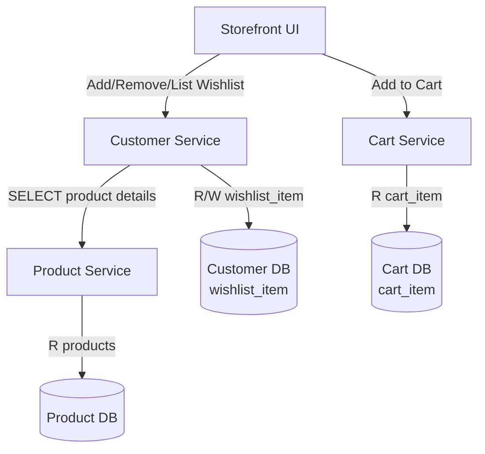
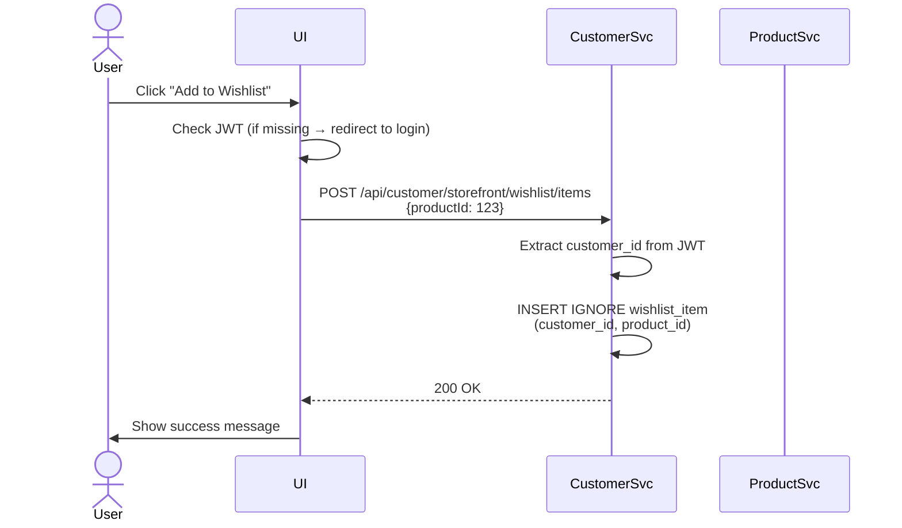
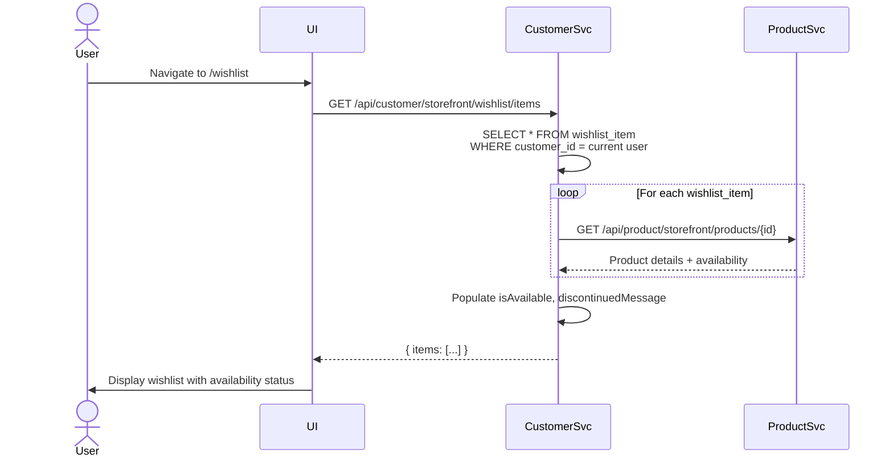
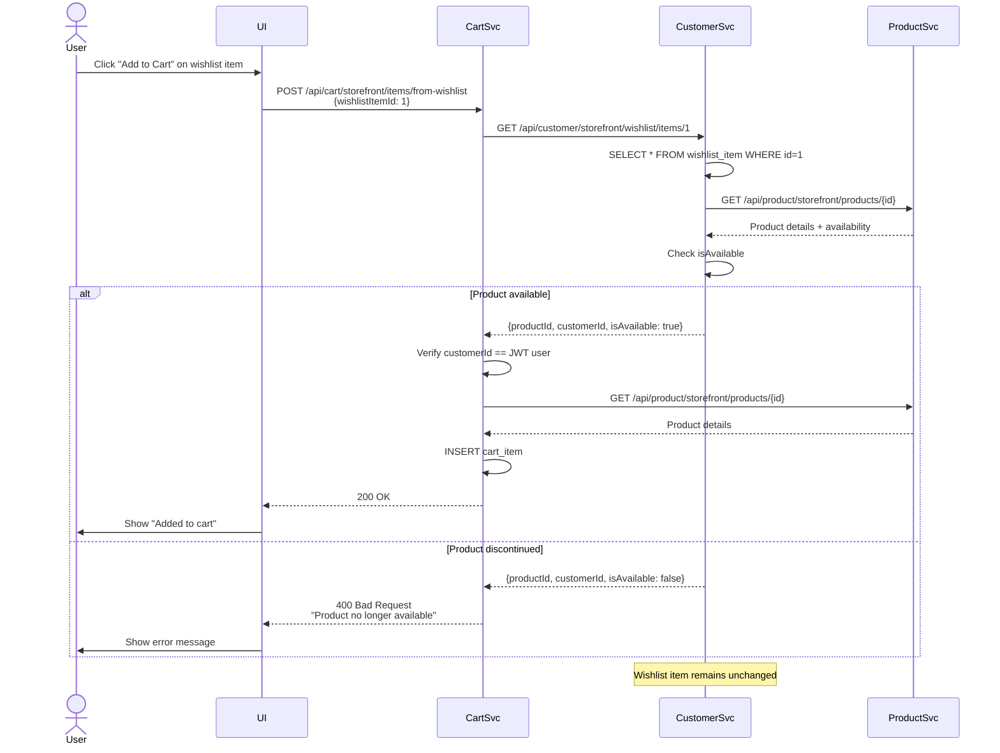

# High-Level Design — PER-316

**Feature:** Signed-in shoppers can save a wishlist and add those items to the cart

---

## Overview

This HLD defines the wishlist persistence schema, REST API contract, and cross-service integration points for the wishlist feature. The customer service owns the wishlist data, the product service provides item details and availability status, and the cart service receives items added from the wishlist.

---

## Architectural Context

**Paradigm:** Microservices architecture with domain-driven boundaries. Each service owns its data and exposes REST APIs. Services communicate synchronously via REST for reads and commands.

**Service Responsibilities:**
- **Customer service** (`customer/`): Owns `wishlist_item` table, provides wishlist CRUD APIs, enforces signed-in-only access
- **Product service** (`product/`): Owns product catalog, provides product detail and availability APIs
- **Cart service** (`cart/`): Owns cart items, provides add-to-cart API, calls customer service to fetch wishlist items when needed

**Technology Stack:**
- Backend: Java 17, Spring Boot 3.x, Maven (matches existing services)
- Database: PostgreSQL with Liquibase migrations (matches existing cart/customer schemas)
- API: REST over HTTP, JSON payloads
- Security: Spring Security with Keycloak JWT authentication (matches existing `SecurityConfig` classes)

---

## Component Diagram



---

## AD-1: Wishlist Storage Schema

**Binds:** `wishlist_item` table structure in customer database  
**Prevents:** Divergent data models between backend and UI; ambiguity over composite keys vs surrogate IDs  
**Rule:**

**Table:** `wishlist_item` (customer database)

| Column | Type | Constraints | Notes |
|--------|------|-------------|-------|
| `id` | BIGINT | PRIMARY KEY, AUTO_INCREMENT | Surrogate key |
| `customer_id` | VARCHAR(255) | NOT NULL | Keycloak user ID from JWT |
| `product_id` | BIGINT | NOT NULL | Foreign key reference (logical, no DB FK) |
| `created_date` | TIMESTAMP | NOT NULL | Audit field |
| `last_modified_date` | TIMESTAMP | | Audit field |

**Constraints:**
- UNIQUE (`customer_id`, `product_id`) — prevents duplicate entries (AC-2)
- Index on `customer_id` for list queries
- No DB-level foreign key to product service (cross-service boundary)

**Rationale:** Composite business key (`customer_id`, `product_id`) with surrogate ID for ORM simplicity. Matches existing `cart_item` pattern (see `cart/src/main/resources/db/changelog/ddl/changelog-0001.sql`). Audit fields follow `AbstractAuditEntity` convention.

---

## AD-2: Wishlist REST API Contract

**Binds:** Endpoint paths, HTTP methods, request/response schemas, status codes  
**Prevents:** Client-server contract drift; unclear responsibility for guest handling  
**Rule:**

**Base URL:** `/api/customer/storefront/wishlist`

### Endpoints

#### `POST /api/customer/storefront/wishlist/items`
Add a product to the wishlist (AC-1, AC-2).

**Request:**
```json
{
  "productId": 123
}
```

**Response:**
- `200 OK` — Product added or already exists (idempotent)
- `401 Unauthorized` — Not signed in (AC-5)
- `404 Not Found` — Product does not exist (call to product service failed)

**Behavior:**
- Extract `customer_id` from JWT (Spring Security `@AuthenticationPrincipal`)
- INSERT if not exists (handle UNIQUE constraint violation silently → idempotent)
- Return success even if product already on list (AC-2)

---

#### `GET /api/customer/storefront/wishlist/items`
List all wishlist items for the signed-in shopper (AC-1, AC-4).

**Response:**
- `200 OK`
```json
{
  "items": [
    {
      "wishlistItemId": 1,
      "productId": 123,
      "productName": "Example Product",
      "productSlug": "example-product",
      "thumbnailUrl": "https://...",
      "price": 29.99,
      "isAvailable": true,
      "discontinuedMessage": null
    },
    {
      "wishlistItemId": 2,
      "productId": 456,
      "productName": "Discontinued Item",
      "productSlug": "discontinued-item",
      "thumbnailUrl": "https://...",
      "price": 49.99,
      "isAvailable": false,
      "discontinuedMessage": "This product is no longer available"
    }
  ]
}
```
- `401 Unauthorized` — Not signed in

**Behavior:**
- SELECT `wishlist_item` WHERE `customer_id` = current user
- For each row, call product service `GET /api/product/storefront/products/{id}` (or batch endpoint if exists)
- Populate `isAvailable` from product's `published` and `in_stock` fields (verify exact field names in `product` service)
- If product not found or `isAvailable == false`, set `isAvailable: false` and `discontinuedMessage` (AC-4)
- Product remains on wishlist even if discontinued

---

#### `DELETE /api/customer/storefront/wishlist/items/{wishlistItemId}`
Remove an item from the wishlist (AC-1).

**Response:**
- `204 No Content` — Deleted successfully
- `401 Unauthorized` — Not signed in
- `404 Not Found` — Item does not exist or does not belong to the current user

**Behavior:**
- DELETE WHERE `id = {wishlistItemId}` AND `customer_id = current user`
- Return 404 if no rows affected (security: cannot delete another user's item)

---

## AD-3: Add Wishlist Item to Cart Integration

**Binds:** How cart service adds a wishlist item to the cart  
**Prevents:** Confusion over whether the cart service reads customer database directly vs calls customer API; whether the item is removed from wishlist  
**Rule:**

**Cart Service Endpoint (new):** `POST /api/cart/storefront/items/from-wishlist`

**Request:**
```json
{
  "wishlistItemId": 1
}
```

**Response:**
- `200 OK` — Item added to cart
- `400 Bad Request` — Product is discontinued (AC-4)
- `401 Unauthorized` — Not signed in
- `404 Not Found` — Wishlist item does not exist or does not belong to user

**Behavior:**
1. Cart service calls customer service `GET /api/customer/storefront/wishlist/items/{wishlistItemId}` (new internal endpoint, see below)
2. Customer service returns `{ productId, customerId, isAvailable }`
3. If `customerId` from response != current JWT user → 403 Forbidden
4. If `isAvailable == false` → 400 Bad Request with message "Product is no longer available"
5. If valid, cart service calls product service `GET /api/product/storefront/products/{productId}` for price/details
6. Cart service inserts into `cart_item` (matches existing `CartItemService.create()` logic)
7. **Wishlist item remains unchanged** (AC-3)

**Customer Service Internal Endpoint (new):** `GET /api/customer/storefront/wishlist/items/{wishlistItemId}`

**Response:**
```json
{
  "wishlistItemId": 1,
  "customerId": "uuid-from-keycloak",
  "productId": 123,
  "isAvailable": true
}
```

This endpoint is for cart service only (authenticated service-to-service, same JWT). UI does not call it directly.

---

## AD-4: Guest Handling

**Binds:** Where and how guest access is blocked  
**Prevents:** Confusion over whether the UI or backend enforces the sign-in requirement  
**Rule:**

**All wishlist endpoints require authentication** (Spring Security: `@PreAuthorize("isAuthenticated()")` or `SecurityConfig` path matcher).

**UI behavior (AC-5):**
- When a guest clicks "Add to Wishlist", the UI checks JWT presence
- If no JWT, redirect to `/login` with return URL
- Backend enforces this as a safety net (401 response if JWT is missing or invalid)

**Backend enforcement:**
- Customer service wishlist controllers extend existing `SecurityConfig` (matches `CustomerController`, `UserAddressController`)
- Use `AuthenticationUtils.getCurrentUserId()` (from `common-library`) to extract `customer_id`
- If principal is null or anonymous → 401 (Spring Security handles this automatically with `@PreAuthorize`)

---

## AD-5: Discontinued Product Query Logic

**Binds:** How the customer service determines product availability  
**Prevents:** Customer service duplicating product business logic; stale availability cache  
**Rule:**

**Customer service does not cache product availability.** Each wishlist list request (`GET /api/customer/storefront/wishlist/items`) calls product service in real time.

**Product service contract (existing, verify endpoint):**
- Endpoint: `GET /api/product/storefront/products/{id}`
- Response includes `published: boolean`, `stockQuantity: number` (or similar fields — verify exact names in `product` service `ProductVm`)

**Customer service logic:**
- Product is **available** if product service returns 200 AND `published == true` AND `stockQuantity > 0` (adjust field names after verification)
- Product is **discontinued** if product service returns 404 OR `published == false`
- If API call fails (timeout, 5xx), treat as unavailable and return generic "Unable to verify availability" message

**Fallback for missing product IDs:**
- If product service returns 404, wishlist item remains in DB
- UI displays the item with `discontinuedMessage: "Product information unavailable"`
- User can still remove the item from wishlist

---

## Component Contracts

### Customer Service → Product Service
- **Endpoint:** `GET /api/product/storefront/products/{id}`
- **Purpose:** Fetch product details and availability for wishlist items
- **Called by:** `WishlistService.getWishlistItems()`
- **Response fields needed:** `id`, `name`, `slug`, `thumbnailMediaUrl`, `price`, `published`, `stockQuantity` (verify exact field names in `product/src/main/java/com/yas/product/viewmodel/product/ProductDetailVm.java` or equivalent)
- **Error handling:** 404 → mark as discontinued; 5xx/timeout → mark as unavailable

### Cart Service → Customer Service
- **Endpoint (new):** `GET /api/customer/storefront/wishlist/items/{wishlistItemId}`
- **Purpose:** Retrieve wishlist item details for add-to-cart operation
- **Called by:** `CartItemService` (new method `addFromWishlist()`)
- **Response fields:** `wishlistItemId`, `customerId`, `productId`, `isAvailable`
- **Security:** Authenticated service call (same JWT); customer service validates `customerId` matches token

### Cart Service → Product Service
- **Endpoint:** `GET /api/product/storefront/products/{id}`
- **Purpose:** Fetch product details for adding to cart (existing call)
- **Called by:** `CartItemService.addFromWishlist()`
- **No change to existing contract**

---

## Data Flow Diagrams

### Add Product to Wishlist



---

### View Wishlist



---

### Add Wishlist Item to Cart



---

## Schema Changes

### Customer Service Database

**Migration:** `customer/src/main/resources/db/changelog/ddl/changelog-0002.sql` (new file)

```sql
CREATE TABLE wishlist_item (
    id BIGSERIAL PRIMARY KEY,
    customer_id VARCHAR(255) NOT NULL,
    product_id BIGINT NOT NULL,
    created_date TIMESTAMP NOT NULL DEFAULT CURRENT_TIMESTAMP,
    last_modified_date TIMESTAMP,
    CONSTRAINT uk_wishlist_customer_product UNIQUE (customer_id, product_id)
);

CREATE INDEX idx_wishlist_customer ON wishlist_item (customer_id);
```

**Liquibase changeset:** Add to `customer/src/main/resources/db/changelog/db.changelog-master.yaml`:
```yaml
- include:
    file: ddl/changelog-0002.sql
```

---

## API Endpoints Summary

### Customer Service (new endpoints)

| Method | Path | Purpose | Auth |
|--------|------|---------|------|
| POST | `/api/customer/storefront/wishlist/items` | Add product to wishlist | Required |
| GET | `/api/customer/storefront/wishlist/items` | List wishlist items | Required |
| DELETE | `/api/customer/storefront/wishlist/items/{id}` | Remove wishlist item | Required |
| GET | `/api/customer/storefront/wishlist/items/{id}` | Get single wishlist item (internal) | Required |

### Cart Service (new endpoint)

| Method | Path | Purpose | Auth |
|--------|------|---------|------|
| POST | `/api/cart/storefront/items/from-wishlist` | Add wishlist item to cart | Required |

---

## Risks and Mitigations

### RISK-1: Product Service Latency on Wishlist List
**Description:** Fetching product details for every wishlist item in a loop could cause slow response times if a user has many items.

**Mitigation:**
- **Preferred:** Implement batch product fetch endpoint in product service: `POST /api/product/storefront/products/batch` with `{"productIds": [123, 456, ...]}`
- **Fallback:** Parallel calls with CompletableFuture or WebClient (non-blocking); timeout after 2s per product
- **Monitoring:** Log slow wishlist list calls; alert if p95 > 1s

**Owner:** Story 1 (backend wishlist API) must decide batch vs parallel strategy

---

### RISK-2: Race Condition on Add-to-Cart from Wishlist
**Description:** If two tabs add the same wishlist item to the cart simultaneously, cart might have duplicate entries.

**Mitigation:**
- Cart service's existing `cart_item` table has UNIQUE constraint on (`customer_id`, `product_id`) (verify in `cart/src/main/resources/db/changelog/ddl/`).
- If constraint exists, INSERT will fail on duplicate → catch and return 200 (idempotent, item already in cart).
- If constraint does not exist, add it in Story 3.

**Owner:** Story 3 (add-to-cart integration)

---

### RISK-3: Orphaned Wishlist Items After Product Deletion
**Description:** If a product is hard-deleted from product service, wishlist items referencing it remain.

**Mitigation:**
- Soft-delete products (set `published = false`) instead of hard-delete — product service decision (outside this feature's scope).
- Wishlist list endpoint handles 404 from product service gracefully (mark as discontinued).
- **Future enhancement:** Periodic cleanup job to remove wishlist items for products deleted > 90 days ago.

**Owner:** Product service (existing behavior); no change needed for this feature

---

### RISK-4: Guest User Experience Confusion
**Description:** Guest clicks "Add to Wishlist" and sees a login redirect, but their cart items are not saved.

**Mitigation:**
- UI shows "Sign in to save items" tooltip on wishlist button when guest.
- Cart items are session-based for guests (existing behavior, out of scope here).
- After sign-in, guest cart is not auto-merged into wishlist (future feature).

**Owner:** Story 2 (UI wishlist page) — add tooltip and disabled state for guests

---

## Open Questions

1. **Product Service Batch Endpoint:** Does product service already have a batch product fetch endpoint? If not, Story 1 must implement parallel calls or propose a batch API addition.
   - **Resolution path:** Check `product/src/main/java/com/yas/product/controller/ProductStorefrontController.java`; if missing, propose in Story 1 LLD.

2. **Cart Item Uniqueness Constraint:** Does `cart_item` table enforce UNIQUE (`customer_id`, `product_id`)? If not, Story 3 must add it.
   - **Resolution path:** Verify in `cart/src/main/resources/db/changelog/ddl/changelog-0001.sql`.

3. **Product Availability Fields:** Exact field names for `published` and `stockQuantity` in product service response — verify in product service ViewModels.
   - **Resolution path:** Story 1 LLD must inspect `product` service code and document actual field names.

---

## Deferred Decisions

- **Wishlist item quantity:** This HLD assumes quantity is always 1 (save product once). Multi-quantity wishlist items are out of scope.
- **Wishlist item notes/comments:** No notes field in schema; deferred to future enhancement.
- **Wishlist sharing/collaborative lists:** Out of scope for this feature.
- **Wishlist-to-order direct conversion:** User must add to cart first; no "buy all wishlist items" shortcut.
- **Notification when discontinued product becomes available:** Out of scope; no background job or webhook.

---

## Notes

- **Idempotency:** Add-to-wishlist and add-to-cart-from-wishlist are idempotent (safe to retry).
- **Consistency Model:** Eventual consistency is acceptable for product availability display (slight staleness is tolerable; no distributed transaction needed).
- **Error Handling:** All APIs return standard `ErrorVm` from `common-library` on failure (matches existing error format).
- **Logging:** Use SLF4J (existing pattern); log wishlist operations at INFO level, errors at ERROR.
- **Testing:** Integration tests in `customer/src/it/` for wishlist CRUD; `cart/src/it/` for add-from-wishlist. Unit tests for service logic.
