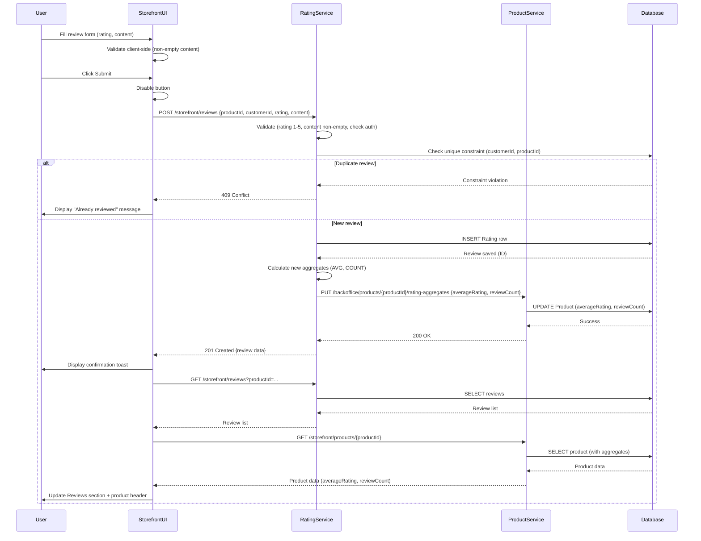

# High-Level Design — PER-327

**Customers can write and submit product reviews**

---

## Overview

This HLD defines the architecture for the product review submission feature. Customers submit reviews (1–5 star rating + written content) from the product detail page. The system validates input, prevents duplicate submissions during processing, persists reviews, recalculates aggregate statistics (average rating, total count), and updates the UI immediately. The design adheres to the existing microservices architecture (Spring Boot backends, Next.js backoffice, React storefront) and aligns with the codebase's established conventions: REST APIs, JPA repositories, React hooks, service-layer validation.

---

## System Context

**Repository:** `app` (yas monorepo)  
**Stack:**  
- Backend: Spring Boot 3.x, JPA/Hibernate, PostgreSQL, Liquibase migrations  
- Backoffice: Next.js (TypeScript), React, service-based API calls  
- Storefront: React (TypeScript), service-based API calls  
- Existing services: `rating`, `product`, `customer` (already exist in codebase)

**Existing related entities (from `rating` service):**  
- `Rating` model: `id`, `productId`, `customerId`, `star`, `content`, `createdOn`, `lastModifiedOn`, `createdBy`, `lastModifiedBy`  
- `RatingRepository`: JPA repository for `Rating`  
- `RatingService`: existing service layer (verify exact methods in `rating/src/main/java/com/yas/rating/service/RatingService.java`)  
- `RatingController`: existing backoffice controller at `rating/src/main/java/com/yas/rating/controller/RatingController.java`

**Existing product service integration:**  
- Product service exposes endpoints for product metadata (verify exact endpoints in `product` service)

---

## Architecture Decisions

### AD-1: Use existing `rating` service for review storage
**Binds:** Review submission POST endpoint, review entity schema  
**Prevents:** Creating a duplicate service or mismatched data model  
**Rule:** All review data lives in the `rating` service's `Rating` table. The `rating` service already exists with a `Rating` model (`id`, `productId`, `customerId`, `star`, `content`, timestamps). Extend this service rather than create a new one.

**[ADOPTED]** — The `rating` service is already present in the codebase.

---

### AD-2: POST /storefront/reviews endpoint contract
**Binds:** Storefront review submission API signature  
**Prevents:** Frontend-backend contract drift  
**Rule:**  
- **Endpoint:** `POST /api/rating/storefront/reviews`  
- **Request body:**  
  ```json
  {
    "productId": <long>,
    "customerId": "<string>",
    "rating": <integer 1-5>,
    "content": "<string>"
  }
  ```
- **Validation (server-side):**  
  - `rating`: integer, range [1, 5]  
  - `content`: non-null, non-empty after trim  
  - `productId`: must reference an existing product (verify in `product` service if needed)  
  - `customerId`: must reference an authenticated customer (extract from security context or validate against `customer` service)
- **Success response (201 Created):**  
  ```json
  {
    "id": <long>,
    "productId": <long>,
    "customerId": "<string>",
    "rating": <integer>,
    "content": "<string>",
    "createdOn": "<ISO 8601 timestamp>"
  }
  ```
- **Error responses:**  
  - 400 Bad Request: invalid rating value, missing/whitespace-only content, missing required fields  
  - 409 Conflict: duplicate review (see AD-4)  
  - 500 Internal Server Error: database or aggregate calculation failure

---

### AD-3: Review entity schema (Rating table)
**Binds:** Database schema for storing reviews  
**Prevents:** Inconsistent storage model  
**Rule:** The `Rating` table (already defined in `rating` service, `rating/src/main/java/com/yas/rating/model/Rating.java`) contains:  
- `id` (Long, primary key, auto-generated)  
- `productId` (Long, not null, indexed — references product)  
- `customerId` (String, not null, indexed — references customer)  
- `star` (Integer, not null, range 1-5)  
- `content` (String, not null)  
- `createdOn` (ZonedDateTime, auto-populated)  
- `lastModifiedOn` (ZonedDateTime, auto-updated)  
- `createdBy` (String, audit field)  
- `lastModifiedBy` (String, audit field)

**Migration:** Verify existing Liquibase changelog (`rating/src/main/resources/db/changelog/ddl/`) includes this schema. If the `Rating` table lacks appropriate indexes on `(productId)` or `(customerId, productId)`, add a new changelog to create them (for duplicate detection and aggregate queries).

---

### AD-4: Idempotency and duplicate prevention strategy
**Binds:** Duplicate review prevention mechanism  
**Prevents:** Multiple identical reviews from repeated button clicks or concurrent requests  
**Rule:**  
- **Strategy:** Database uniqueness constraint on `(customerId, productId)` in the `Rating` table, enforcing one review per customer per product.  
- **Behavior:** If a customer attempts to submit a second review for the same product, the database constraint violation triggers a `DataIntegrityViolationException` (JPA), which the service layer catches and maps to a 409 Conflict response with message: `"You have already submitted a review for this product."`.  
- **Client-side button disable:** Optional (UI improvement). The primary enforcement is server-side.  
- **Request tokens:** Not required. The uniqueness constraint is sufficient.

**Migration:** Add a Liquibase changelog to create a unique index `UNIQUE (customerId, productId)` on the `Rating` table if it does not already exist.

---

### AD-5: Aggregate rating calculation strategy
**Binds:** How product average rating and review count are computed  
**Prevents:** Inconsistent or stale statistics  
**Rule:**  
- **Calculation:** Average rating = `SUM(star) / COUNT(*)` for all reviews of a product, rounded to one decimal place (e.g. `4.3`). Total count = `COUNT(*)`.  
- **Storage:** Aggregate statistics are stored in the `product` service's `Product` table (verify exact column names in `product/src/main/java/com/yas/product/model/Product.java` — expect `averageRating` (Decimal/Double) and `reviewCount` (Long/Integer)).  
- **Update trigger:** After every successful review submission (POST), the `rating` service **synchronously** recalculates aggregates and calls the `product` service to update them (REST call: `PUT /api/product/backoffice/products/{productId}/rating-aggregates` with body `{"averageRating": <decimal>, "reviewCount": <integer>}`). This ensures immediate consistency per AC-9.  
- **Failure handling:** If the aggregate update call fails (product service down, network error), log the error and return 500 to the client. The review is already persisted; a background job or manual reconciliation can fix the aggregate later (deferred decision: add a reconciliation job if needed).

**[ASSUMPTION]** — The `product` service does not currently expose a rating-aggregate update endpoint. The architect must verify and define this in the HLD. If it does not exist, it must be added.

---

### AD-6: Review retrieval for product detail page
**Binds:** How the frontend fetches reviews for display  
**Prevents:** Client-side data inconsistency  
**Rule:**  
- **Endpoint:** `GET /api/rating/storefront/reviews?productId={productId}&pageNo={pageNo}&pageSize={pageSize}` (paginated)  
- **Response:**  
  ```json
  {
    "reviews": [
      {
        "id": <long>,
        "customerId": "<string>",
        "rating": <integer>,
        "content": "<string>",
        "createdOn": "<ISO 8601 timestamp>"
      }
    ],
    "totalPages": <integer>,
    "totalElements": <long>,
    "pageNo": <integer>,
    "pageSize": <integer>
  }
  ```
- **Sorting:** Reviews ordered by `createdOn DESC` (newest first).  
- **Caching:** No client-side caching for review list (always fetch fresh on page load/refresh to satisfy AC-12). Server-side caching is deferred.

---

### AD-7: Product aggregate retrieval (average rating, count)
**Binds:** How the frontend fetches aggregate statistics for display  
**Prevents:** Duplicate data sources  
**Rule:**  
- **Source:** The `product` service's existing product detail endpoint (verify exact endpoint in `product` service, e.g. `GET /api/product/storefront/products/{productId}` or `GET /api/product/storefront/products/slug/{slug}`).  
- **Response includes:** `averageRating` (Decimal), `reviewCount` (Long).  
- **Consistency requirement (AC-9):** The product header and Reviews section must display the same values. Both must call the same product detail endpoint (not separate aggregate endpoints) to ensure consistency.

---

### AD-8: Frontend form validation
**Binds:** Client-side validation rules  
**Prevents:** Unnecessary server round-trips for obvious errors  
**Rule:**  
- **Star rating:** Selector enforces 1-5 (UI does not allow out-of-range selection).  
- **Review content:** HTML5 `required` attribute + React hook validation (non-empty after trim). Display inline error message: `"Review content is required."` if violated.  
- **Submit button:** Disable during API call (async request in flight) to prevent repeated clicks (AC-11). Re-enable on success/error response.  
- **Server validation is authoritative:** Client validation is a convenience; the server enforces all rules.

---

### AD-9: Error handling and user feedback
**Binds:** How errors are communicated to the user  
**Prevents:** Silent failures or confusing error states  
**Rule:**  
- **Validation errors (400):** Display field-specific error messages above the form (e.g. `"Rating must be between 1 and 5."`, `"Review content cannot be empty."`).  
- **Duplicate review (409):** Display message: `"You have already submitted a review for this product."` (do not create duplicate).  
- **Server errors (500):** Display generic message: `"An error occurred. Please try again later."` Do not update UI statistics on error (AC-10).  
- **Success (201):** Display confirmation toast: `"Thank you! Your review has been submitted."` Refresh the reviews list (fetch `GET /storefront/reviews?productId=...`) and product detail (fetch `GET /storefront/products/{id}`) to show updated data.

---

### AD-10: Security and authorization
**Binds:** Who can submit reviews  
**Prevents:** Unauthenticated or unauthorized submissions  
**Rule:**  
- **Authentication required:** The `POST /storefront/reviews` endpoint requires an authenticated customer (Spring Security / Keycloak token). The `customerId` is extracted from the security context (via `AuthenticationUtils.extractUserId()` per existing pattern in the codebase).  
- **Authorization:** Only the authenticated customer can submit a review under their own `customerId`. The API does not accept `customerId` in the request body from the client; it is server-assigned from the token.  
- **Unauthenticated users:** Return 401 Unauthorized if no valid token is present.

---

### AD-11: Testing strategy
**Binds:** Test coverage for the feature  
**Prevents:** Untested edge cases  
**Rule:**  
- **Unit tests (backend):**  
  - `RatingService`: test validation logic (rating range, content trim), duplicate detection (unique constraint violation), aggregate calculation formula.  
  - `RatingController`: test endpoint contract (request/response format, status codes).  
  - Mock `ProductService` calls for aggregate updates.
- **Integration tests (backend):**  
  - `RatingControllerIT`: test full flow (POST → save → aggregate update → GET retrieval) against real database (Testcontainers PostgreSQL).  
  - Test duplicate prevention (submit twice, expect 409 on second attempt).  
  - Test rating recalculation accuracy (submit multiple reviews, verify average and count).
- **Frontend tests:**  
  - Component tests (React Testing Library): test form validation, button disable during submission, error message display.  
  - E2E tests (optional, Playwright): test full user flow (fill form → submit → see confirmation → see new review in list).

---

## Component Interactions



---

## Data Model

### Rating table (existing, extended)
```sql
CREATE TABLE rating (
  id BIGSERIAL PRIMARY KEY,
  product_id BIGINT NOT NULL,
  customer_id VARCHAR(255) NOT NULL,
  star INTEGER NOT NULL CHECK (star BETWEEN 1 AND 5),
  content TEXT NOT NULL,
  created_on TIMESTAMP WITH TIME ZONE NOT NULL,
  last_modified_on TIMESTAMP WITH TIME ZONE NOT NULL,
  created_by VARCHAR(255),
  last_modified_by VARCHAR(255),
  CONSTRAINT uq_customer_product UNIQUE (customer_id, product_id)
);

CREATE INDEX idx_rating_product_id ON rating (product_id);
```

### Product table (existing, verify columns)
Verify the `product` service's `Product` entity includes:
```java
@Column(name = "average_rating")
private BigDecimal averageRating;

@Column(name = "review_count")
private Long reviewCount;
```
If these columns do not exist, add a Liquibase migration in the `product` service to add them.

---

## API Contracts

### POST /api/rating/storefront/reviews
**Request:**
```json
{
  "productId": 123,
  "rating": 5,
  "content": "Excellent product!"
}
```
**Note:** `customerId` is extracted from the authenticated user's security context, not sent by the client.

**Success Response (201 Created):**
```json
{
  "id": 456,
  "productId": 123,
  "customerId": "user-uuid",
  "rating": 5,
  "content": "Excellent product!",
  "createdOn": "2025-05-23T14:35:00Z"
}
```

**Error Responses:**
- **400 Bad Request:**
  ```json
  {
    "status": 400,
    "title": "Bad Request",
    "detail": "Rating must be between 1 and 5."
  }
  ```
- **409 Conflict:**
  ```json
  {
    "status": 409,
    "title": "Conflict",
    "detail": "You have already submitted a review for this product."
  }
  ```
- **500 Internal Server Error:**
  ```json
  {
    "status": 500,
    "title": "Internal Server Error",
    "detail": "An error occurred while processing your request."
  }
  ```

---

### GET /api/rating/storefront/reviews
**Query Parameters:**
- `productId` (required): Long
- `pageNo` (optional, default 0): Integer
- `pageSize` (optional, default 10): Integer

**Success Response (200 OK):**
```json
{
  "reviews": [
    {
      "id": 456,
      "customerId": "user-uuid",
      "rating": 5,
      "content": "Excellent product!",
      "createdOn": "2025-05-23T14:35:00Z"
    }
  ],
  "totalPages": 1,
  "totalElements": 1,
  "pageNo": 0,
  "pageSize": 10
}
```

---

### PUT /api/product/backoffice/products/{productId}/rating-aggregates
**Request:**
```json
{
  "averageRating": 4.3,
  "reviewCount": 42
}
```

**Success Response (200 OK):**
```json
{
  "productId": 123,
  "averageRating": 4.3,
  "reviewCount": 42
}
```

**[ASSUMPTION]** — This endpoint does not currently exist in the `product` service. It must be added.

---

## Deferred Decisions

1. **Aggregate reconciliation job:** If the aggregate update call to the product service fails, should a background job periodically reconcile aggregates from the rating table? (Deferred to post-MVP unless frequent failures occur.)
2. **Review editing/deletion:** Not in scope for this feature. Customers cannot edit or delete submitted reviews.
3. **Review moderation:** No moderation workflow (approval, flagging, admin review) in this feature.
4. **Customer name display:** The current design stores only `customerId`. If the UI should display customer names, the frontend must call the `customer` service to resolve names (or the review retrieval endpoint must join/enrich with customer names). This is a UX decision deferred to the designer.
5. **Review sorting options:** Only `createdOn DESC` is implemented. Additional sorting (most helpful, highest/lowest rating) is deferred.
6. **Review pagination on product detail page:** The frontend must handle pagination (load more / infinite scroll). The API supports it; the UI implementation is a frontend story detail.

---

## Open Questions

1. **Does the `product` service's `Product` entity already have `averageRating` and `reviewCount` columns?** (Verify in `product/src/main/java/com/yas/product/model/Product.java`.)
2. **Does the `rating` service's `Rating` table already have a unique constraint on `(customerId, productId)`?** (Verify in Liquibase changelogs under `rating/src/main/resources/db/changelog/ddl/`.)
3. **What is the exact endpoint for updating product aggregates in the `product` service?** (Verify or define new endpoint.)
4. **Should the review retrieval endpoint include customer names, or is `customerId` sufficient?** (UX decision — deferred to designer.)
5. **Is there a maximum length for review content?** (Requirements doc lists this as an open question — decision needed before backend validation implementation.)

---

## Risks

1. **Product service aggregate update failure:** If the `product` service is down or slow, review submission may fail or timeout. Mitigation: add retry logic or circuit breaker (Spring Cloud Resilience4j pattern already in use — verify in `AbstractCircuitBreakFallbackHandler`), or accept eventual consistency with a reconciliation job.
2. **Concurrent submission race:** Two simultaneous requests from the same user might both pass uniqueness checks before the constraint is enforced. Mitigation: the database unique constraint is the final arbiter; one request will succeed, the other will fail with 409. No additional locking needed.
3. **Large review content:** No max length currently defined. If users submit very large text, it may cause performance or storage issues. Mitigation: define and enforce a max length (e.g. 5000 characters) in requirements and validation.
4. **Average rating precision:** Rounding to one decimal place may cause minor discrepancies in display (e.g. `4.3` vs `4.33`). Mitigation: document the rounding rule and ensure consistency across all display locations.

---

## Implementation Notes

### Backend (rating service)
- **New files:**
  - `rating/src/main/java/com/yas/rating/controller/StorefrontReviewController.java` (or add methods to existing controller)
  - `rating/src/main/java/com/yas/rating/viewmodel/ReviewPostVm.java` (request DTO)
  - `rating/src/main/java/com/yas/rating/viewmodel/ReviewVm.java` (response DTO)
  - `rating/src/main/java/com/yas/rating/viewmodel/ReviewListVm.java` (paginated response DTO)
- **Modified files:**
  - `rating/src/main/java/com/yas/rating/service/RatingService.java` (add `createReview`, `getReviewsByProductId`, `calculateAggregates` methods)
  - `rating/src/main/resources/db/changelog/ddl/changelog-000X.sql` (add unique constraint + indexes if missing)
- **New dependencies (if needed):**
  - Spring Cloud OpenFeign or RestTemplate for calling product service (verify existing pattern in `rating` service)

### Backend (product service)
- **New files:**
  - `product/src/main/java/com/yas/product/controller/ProductAggregateController.java` (or add method to existing backoffice controller)
  - `product/src/main/java/com/yas/product/viewmodel/RatingAggregatePostVm.java` (request DTO)
- **Modified files:**
  - `product/src/main/java/com/yas/product/model/Product.java` (add `averageRating`, `reviewCount` columns if missing)
  - `product/src/main/java/com/yas/product/service/ProductService.java` (add `updateRatingAggregates` method)
  - `product/src/main/resources/db/changelog/ddl/changelog-000X.sql` (add columns if missing)

### Frontend (storefront)
- **New files:**
  - `storefront/modules/review/components/ReviewForm.tsx` (form component)
  - `storefront/modules/review/services/ReviewService.ts` (API client)
  - `storefront/modules/review/models/Review.ts` (TypeScript types)
- **Modified files:**
  - `storefront/pages/products/[id].tsx` (or wherever product detail page lives — verify exact path)
  - `storefront/modules/catalog/components/ProductDetailReviews.tsx` (or similar — add review submission form + list)

### Testing
- **Backend unit tests:**
  - `rating/src/test/java/com/yas/rating/service/RatingServiceTest.java`
  - `rating/src/test/java/com/yas/rating/controller/StorefrontReviewControllerTest.java`
- **Backend integration tests:**
  - `rating/src/it/java/com/yas/rating/service/RatingServiceIT.java`
  - `rating/src/it/java/com/yas/rating/controller/StorefrontReviewControllerIT.java`
- **Frontend tests:**
  - `storefront/modules/review/components/ReviewForm.test.tsx`

---

## Acceptance Criteria Coverage

| AC | Coverage |
|----|----------|
| AC-1 | AD-2 (endpoint validation), AD-8 (client-side selector enforces 1-5) |
| AC-2 | AD-2 (server validation: content non-null, non-empty after trim), AD-8 (client-side required field) |
| AC-3 | AD-2 (server validation rejects missing fields), AD-8 (client-side validation prevents submission) |
| AC-4 | AD-2 (server validation rejects rating < 1 or > 5, returns 400) |
| AC-5 | AD-2 (201 response on success), AD-9 (confirmation message), Component Interactions diagram |
| AC-6 | AD-6 (GET /storefront/reviews retrieval), AD-9 (UI refresh after submission) |
| AC-7 | AD-5 (aggregate calculation formula: AVG, synchronous update) |
| AC-8 | AD-5 (review count = COUNT(*), synchronous update) |
| AC-9 | AD-7 (product header and Reviews section both fetch from product detail endpoint, ensuring consistency) |
| AC-10 | AD-9 (error response handling, no UI update on error) |
| AC-11 | AD-4 (database uniqueness constraint prevents duplicates), AD-8 (button disable during request), AD-9 (409 response on duplicate attempt) |
| AC-12 | AD-6 (reviews retrieved from database on page load, no stale client-side cache) |

---

**End of HLD**
